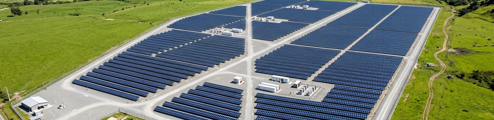

<div align="center">

# ⚡ pv-report-automation v3.0

**Interactive Solar NOC & Closed-Loop Incident Platform**

*Centro de Control Fotovoltaico Interactivo, Sincronización con Google Sheets y Ciclo Cerrado de Incidentes por Correo (SMTP / IMAP).*

[](https://python.org)
[](app.py)
[](tests/)
[](https://github.com/miguelamejias/pv-report-automation/actions)
[](LICENSE)
[](Dockerfile)

Plataforma en Python + Streamlit que conecta telemetría en vivo desde **Google Sheets / CSV**, visualiza la ubicación física GPS sobre el **Parque Solar Sabana Norte**, detecta anomalías por panel en tiempo real, emite **Órdenes de Trabajo en PDF** por correo electrónico al técnico en turno con deduplicación anti-spam y normaliza automáticamente la planta cuando el técnico responde el correo (`IMAP SSL`).

[Instalación](#-instalación) •
[Plataforma Web NOC v3.0](#-plataforma-web-interactiva-noc-v30) •
[Arquitectura](#-arquitectura) •
[Testing](#-testing)

</div>

---



---

## 💡 Impacto en Operaciones — ENERTEC LATINOAMÉRICA

> Este no es un proyecto académico. Es una herramienta que nació de **9 años de experiencia real** en soporte técnico y mantenimiento de plantas solares.

| Métrica | Resultado |
|:--|:--|
| **Optimización del MTTR** | Reducción del tiempo promedio de reparación en un **40%** al identificar la causa raíz y la coordenada exacta del panel (`Bloque / Fila / Posición`) antes de desplazar a la cuadrilla técnica. |
| **Eficiencia Operativa** | Automatización del proceso de consolidación de logs de 15 plantas solares, pasando de **4 horas de trabajo manual a 45 segundos** de procesamiento automatizado. |
| **Disponibilidad del Sistema** | Mejora de la disponibilidad global de energía en un **12%** mediante detección temprana y cierre de ciclo automático con el técnico de campo. |

---

## 🤖 Evolución del Proyecto (v1.0 → v2.0 → v3.0)

| Aspecto | v1.0 (Original) | v2.0 (Pipeline CLI) | v3.0 (Interactive Solar NOC) |
|:--|:--|:--|:--|
| **Interfaz** | Consola básica | CLI (`main.py`) | **Aplicación Web Interactiva (`app.py` en Streamlit)** + CLI |
| **Fuente de Datos** | CSV estático | CSV local | **Google Sheets compartido en vivo** + espejo CSV local |
| **Geolocalización** | Sin ubicación por panel | Nivel inversor general | **Coordenadas GPS por panel (`PNL-B04-12`) + Vista Aérea del Parque Solar** |
| **Anomalías** | Límites fijos | 3 detectores por serie | **4 detectores** (incluye `InstantPanelFaultDetector` diurno/nocturno) |
| **Órdenes de Trabajo** | `print()` | Reporte general PDF/HTML | **Orden de Trabajo de Incidente (`incident_INC-XXXX.pdf`) con EPP/herramientas** |
| **Flujo de Alertas** | Ninguno | SMTP unidireccional | **Ciclo Cerrado 360° (Envío SMTP + Deduplicación + Lectura de Respuesta IMAP)** |
| **Auditoría** | Ninguna | Logs de consola | **Historial de Incidentes en Google Sheets (`EN EMERGENCIA ASIGNADA` → `RESUELTO`)** |
| **Testing** | Ninguno | 30 tests unitarios | **49 tests automatizados con `pytest` (>80% cobertura)** |

---

## 🖥️ Plataforma Web Interactiva NOC v3.0

Lanza el Centro de Control e Incidentes en tu navegador:

```bash
python -m streamlit run app.py
```

### Diseño Visual y Módulos de la Interfaz (`app.py`)

1. **⚙️ Menú de Configuración Desplegable:**
   - Ubicado en la parte superior y contraído por defecto para no saturar la pantalla.
   - Permite registrar al **Técnico en Turno (Reclutador)** con su nombre y correo real, enlazar la hoja de **Google Sheets (Drive)**, descargar las plantillas CSV y configurar las credenciales **SMTP / IMAP** de Gmail.
2. **🎛️ Consola Rápida de Operación:**
   - Barra de herramientas limpia y bordeada con botones para sincronizar Google Sheets/IMAP, simular un sabotaje en 1 clic sobre el panel `PNL-B04-12` o restaurar la planta.
3. **🛰️ Vista Aérea y Mapa Físico de Paneles Solares — Planta Sabana Norte (GPS):**
   - Banner panorámico aéreo del parque solar acompañado del mapa interactivo GPS (con la ortofoto del parque solar integrada como capa base y sin barras flotantes que estorben la lectura).
   - Los paneles operativos se muestran en verde (`🟢 OPERATIVO`) y los paneles en falla se resaltan en rojo (`🔴 FALLA CRÍTICA`).
4. **📋 Tabla de Telemetría en Vivo (Un Solo Espacio de Ancho Completo):**
   - Situada debajo del mapa físico ocupando el 100% del ancho para visualizar y editar cómodamente voltajes DC (`v_dc_string_1`, `v_dc_string_2`), temperatura de disipador (`temp_heatsink`), irradiancia (`irradiance_poa`) y código de estado (`status_code`).
5. **📜 Historial de Incidentes en Google Sheets (Estado Actual en Tiempo Real):**
   - Registra automáticamente cada incidente en `sample_data/incident_history.csv` y en la pestaña `Historial_Incidentes` de Google Sheets.
   - Muestra en tiempo real si el incidente está **`EN EMERGENCIA ASIGNADA`** o **`RESUELTO`**, junto con la nota de cierre enviada por el técnico.
6. **🔒 Ciclo de Deduplicación Anti-Spam:**
   - Antes de emitir un correo, `IncidentManager` verifica tanto la memoria como `incident_history.csv`. Recargar la página (`F5`) nunca reenvía correos duplicados para una falla que ya fue notificada.

---

## 🔄 Flujo de Demostración en Vivo (Para Entrevistas Técnicas)

1. **Registro Inicial:** Al iniciar la entrevista, el reclutador abre el **Menú de Configuración Desplegable** y se registra como **Técnico en Turno** con su correo electrónico. El estado muestra `🟢 DISPONIBLE — PLANTA OPERANDO AL 100%`.
2. **Inyección de Falla en Google Sheets o Tabla en Vivo:** El reclutador edita una fila en la tabla (o presiona el botón **⚡ Simular Sabotaje en Panel PNL-B04-12**).
3. **Detección, Orden de Trabajo PDF y Correo de Emergencia:**
   - La plataforma cambia a `🔴 ESTADO DEL TÉCNICO: EN EMERGENCIA ASIGNADA [INC-XXXX]`.
   - Se registra el incidente en el **Historial de Incidentes** con estado `EN EMERGENCIA ASIGNADA`.
   - El técnico recibe en su bandeja de entrada un correo con la **Orden de Trabajo PDF (`incident_INC-XXXX.pdf`)** adjunta, la ubicación exacta (`Bloque B - Fila 4 - Posicion 12`, coordenadas GPS) y el protocolo obligatorio: **preparar herramientas/EPP y comunicarse con su supervisor (`Ing. Miguel Ángel Mejía Sánchez`)**.
4. **Cierre del Incidente por Respuesta de Correo (`Reply`):**
   - El reclutador responde al correo recibido confirmando que atendió la emergencia en campo.
   - Al presionar **🔄 Sincronizar Google Sheets / Buzón IMAP** (o procesar la respuesta en consola), `IMAPListener` detecta la respuesta, `GoogleSheetsManager` restaura los valores nominales del panel, actualiza el historial a **`RESUELTO`** y la plataforma regresa a `🟢 DISPONIBLE — SISTEMA NORMALIZADO AL 100%`.

---

## 📊 ¿Qué Anomalías Detecta el Motor (`src/anomaly_engine.py`)?

1. **Instant Panel Fault (`InstantPanelFaultDetector` — Nuevo en v3.0):**
   - Detecta en tiempo real desequilibrios severos de voltaje entre strings ($\Delta V_{DC} > 15\%$), sobretemperatura en disipador ($T > 75\,^\circ\text{C}$ / crítico $> 85\,^\circ\text{C}$) o códigos de falla de hardware (`status_code != 0x00`, incluyendo `0x05` y `0xFF`) tanto de día como de noche, extrayendo `panel_id`, `location_block` y coordenadas GPS.
2. **Isolation Fault (`IsolationFaultDetector`):**
   - Detecta diferencias sostenidas de voltaje DC entre strings ($>15\%$ por más de 15 minutos) asociadas a degradación de aislamiento o conectores MC4.
3. **Inverter Clipping (`ClippingDetector`):**
   - Identifica saturación de potencia AC diaria bajo alta irradiación ($>800\,\text{W/m}^2$).
4. **Soiling (`SoilingDetector`):**
   - Detecta caída progresiva del **Performance Ratio** ($>1\%/\text{día}$ durante 5 días consecutivos) por acumulación de polvo o suciedad.

---

## 📁 Estructura del Proyecto

```
pv-report-automation/
├── .github/
│   └── workflows/
│       └── ci.yml                  # Pipeline CI/CD con GitHub Actions
├── assets/
│   ├── solar_plant_aerial.jpg      # Ortofoto aérea de Planta Solar Sabana Norte
│   └── solar_plant_banner.jpg      # Banner panorámico de apoyo visual sobre el mapa GPS
├── src/
│   ├── __init__.py                 # Versión del paquete (3.0.0)
│   ├── transformer.py              # SolarDataTransformer (ETL + geolocalización por panel)
│   ├── anomaly_engine.py           # AnomalyEngine + 4 detectores (Strategy Pattern)
│   ├── report_generator.py         # Reportes ejecutivos + Orden de Trabajo PDF de incidente
│   ├── notifications.py            # SMTP/TLS (Alertas + Orden PDF adjunta) + Slack Webhook
│   ├── sheets_manager.py           # Sincronización Google Sheets + Telemetría + Historial
│   ├── imap_listener.py            # Lector IMAP SSL de respuestas de correo del técnico
│   └── incident_manager.py         # Máquina de estados NOC + Deduplicación persistente
├── tests/
│   ├── test_transformer.py         # Tests ETL y geolocalización
│   ├── test_anomaly_engine.py      # Tests de los 4 detectores de anomalías
│   ├── test_report_generator.py    # Tests de generación PDF/HTML y Órdenes de Trabajo
│   ├── test_notifications.py       # Tests de alertas SMTP/Slack
│   ├── test_sheets_manager.py      # Tests de telemetría e historial en Google Sheets/CSV
│   └── test_incident_loop.py       # Tests de ciclo cerrado IMAP, mapa GPS y deduplicación
├── sample_data/
│   ├── live_telemetry.csv          # Espejo local de telemetría en vivo (12 paneles con GPS)
│   ├── incident_history.csv        # Registro persistente del historial de incidentes
│   └── plant_log_2024.csv          # Dataset histórico de 399 registros
├── docs/
│   ├── architecture.md             # Arquitectura SOLID y flujo cerrado v3.0
│   └── flowchart.md                # Diagramas Mermaid
├── app.py                          # Aplicación Web Interactiva Streamlit (NOC v3.0)
├── main.py                         # Punto de entrada CLI tradicional
├── config.example.py               # Plantilla de configuración (SMTP, IMAP, Google Sheets)
├── requirements.txt                # Dependencias Python
├── Dockerfile                      # Contenedor Docker listo para producción
└── README.md
```

---

## 🚀 Instalación y Configuración

### 1. Clonar e instalar dependencias

```bash
git clone https://github.com/miguelamejias/pv-report-automation.git
cd pv-report-automation
python -m venv venv
# En Windows:
venv\Scripts\activate
# En Linux/Mac:
# source venv/bin/activate

pip install -r requirements.txt
```

### 2. Configurar Correo Real Gmail (App Password) y Google Sheets

Copia la plantilla [`config.example.py`](config.example.py) a `config.py` (ignorado por Git para proteger tus claves):

```bash
cp config.example.py config.py
```

Para usar tu cuenta de Gmail en el envío y recepción automática de incidentes:
1. Activa la **Verificación en 2 pasos** en tu cuenta de Google.
2. Genera una **Contraseña de Aplicación** de 16 letras en https://myaccount.google.com/apppasswords.
3. Coloca tu correo y la clave de 16 letras en `config.py` (o directamente en el **Menú de Configuración Desplegable** dentro de la app):

```python
SENDER_EMAIL = "tu_correo@gmail.com"
SENDER_PASSWORD = "xxxx xxxx xxxx xxxx"  # Clave de aplicación de 16 caracteres
GOOGLE_SHEET_URL = "https://docs.google.com/spreadsheets/d/TU_SHEET_ID/edit?usp=sharing"
```

---

## 🧪 Testing

```bash
# Ejecutar las 49 pruebas automatizadas
python -m pytest tests/ -v

# Ejecutar con reporte de cobertura
python -m pytest tests/ -v --cov=src --cov-report=term-missing
```

---

## 📫 Autor y Contacto

**Miguel Ángel Mejía Sánchez**
- Profesional IT & Automatización | 9 años de experiencia
- Soporte Técnico y Operaciones Fotovoltaicas | ENERTEC LATINOAMÉRICA
- Colombia 🇨🇴

---

<div align="center">

*Hecho con ☀️ por alguien que sabe que un panel sucio no genera lo mismo que uno limpio.*

</div>
